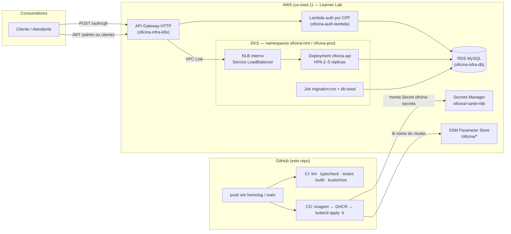

# oficina-api — API da Oficina Mecânica (Tech Challenge SOAT, Fase 3)

Aplicação principal do **Sistema Integrado de Atendimento e Execução de Serviços** de uma
oficina mecânica: **Ordens de Serviço (OS)**, clientes, veículos, serviços, peças/estoque e
pagamentos. Roda em **Kubernetes (Amazon EKS)** atrás de um **API Gateway**, com banco
gerenciado (**RDS MySQL**) e deploy automático por ambiente.

Desenvolvido com **AdonisJS v6 + TypeScript**, Lucid ORM e arquitetura **DDD / Clean
Architecture** com Linguagem Ubíqua em português.

## Propósito deste repositório

Na Fase 3 o projeto foi segregado em **quatro repositórios**; este é a aplicação:

| Repositório | Papel |
| --- | --- |
| **`oficina-api`** (este) | API AdonisJS, manifestos Kubernetes (Kustomize) e pipeline de CI/CD que publica a imagem e faz o deploy no EKS |
| [`oficina-infra-k8s`](https://github.com/Fabio-GST/oficina-infra-k8s) | Terraform da VPC, do cluster EKS (namespaces `oficina-hml`/`oficina-prod`, metrics-server) e do API Gateway com VPC Link |
| [`oficina-infra-db`](https://github.com/Fabio-GST/oficina-infra-db) | Terraform do RDS MySQL por ambiente, credenciais no Secrets Manager e modelo de dados (ER) |
| [`oficina-auth-lambda`](https://github.com/Fabio-GST/oficina-auth-lambda) | Function serverless que autentica o **cliente por CPF** e emite o JWT aceito por esta API |

Os repositórios se comunicam por parâmetros no **SSM Parameter Store** (`/oficina/*`) e
segredos no **Secrets Manager** (`oficina/<ambiente>/db`), sem acoplar os states do Terraform.

### Tecnologias

AdonisJS 6 · TypeScript · Lucid (MySQL 8 / SQLite nos testes) · VineJS · JWT HS256 ·
Japa (testes) · Docker · Kubernetes (EKS) + Kustomize · GitHub Actions · AWS (EKS, RDS, API
Gateway, SSM, Secrets Manager) em conta **AWS Academy Learner Lab**.

---

## Sumário

- [Arquitetura da solução (Fase 3)](#arquitetura-da-solução-fase-3)
- [Deploy automático no EKS (CI/CD)](#deploy-automático-no-eks-cicd)
- [Fase 2 — Objetivos](#fase-2--objetivos)
- [Documentação](#documentação)
- [Collection das APIs](#collection-das-apis)
- [Arquitetura](#arquitetura)
- [Por que MySQL](#por-que-mysql)
- [Como executar com Docker](#como-executar-com-docker-recomendado)
- [Como executar localmente](#como-executar-localmente)
- [Autenticação](#autenticação)
- [Endpoints](#endpoints)
- [Observabilidade: correlação e healthcheck](#observabilidade-correlação-e-healthcheck)
- [Deploy em Kubernetes](#deploy-em-kubernetes)
- [Testes e cobertura](#testes-e-cobertura)
- [Segurança](#segurança)

---

## Arquitetura da solução (Fase 3)



- **Dois tipos de JWT, um só segredo (HS256)**: o administrador faz login por e-mail/senha nesta
  API (`papel: admin`); o cliente faz login por CPF na Function (`papel: cliente`). O mesmo
  middleware verifica os dois e um guard de papel protege as rotas administrativas.
- **Ambientes**: `homolog` → namespace `oficina-hml`; `main` → `oficina-prod`, no mesmo cluster
  (um cluster por ambiente dobraria o custo fixo do EKS no crédito da Academy).
- **Sem IAM próprio** (restrição do Learner Lab): não há OIDC, IRSA nem AWS Load Balancer
  Controller. O NLB é o nativo do `Service type=LoadBalancer` e o Secret do Kubernetes é montado
  pelo pipeline a partir do Secrets Manager.

---

## Deploy automático no EKS (CI/CD)

| Workflow | Gatilho | O que faz |
| --- | --- | --- |
| [`ci.yml`](./.github/workflows/ci.yml) | PR e push em `homolog`/`main` | lint, typecheck, testes (SQLite), build, build da imagem sem push e renderização dos overlays Kustomize |
| [`cd.yml`](./.github/workflows/cd.yml) | push em `homolog` (→ **hml**) e `main` (→ **prod**) | build/push da imagem no GHCR (`sha` + `hml`/`prod`), kubeconfig via SSM `/oficina/eks/nome`, Secret a partir do Secrets Manager, `kubectl kustomize overlays/<amb> \| kubectl apply`, Job de migração, `rollout status` e smoke test pela URL do API Gateway |

### Secrets e variáveis necessários no GitHub

Em **Settings → Environments** crie `hml` e `prod` (em `prod`, adicione *required reviewers*
para aprovação manual) e configure em cada um:

| Secret | Origem |
| --- | --- |
| `AWS_ACCESS_KEY_ID`, `AWS_SECRET_ACCESS_KEY`, `AWS_SESSION_TOKEN` | Credenciais temporárias do Learner Lab (painel *AWS Details* → *AWS CLI*). **Expiram a cada sessão**: atualize após cada *Start Lab*, antes de fazer push |
| `APP_KEY` | 32+ caracteres aleatórios (`node ace generate:key`) |
| `JWT_SECRET` | Segredo HS256 — **o mesmo** configurado na Function `oficina-auth-lambda` do ambiente |
| `WEBHOOK_SECRET` | Segredo do webhook de decisão de orçamento |
| `NEW_RELIC_LICENSE_KEY` | *Ingest license key* da conta New Relic (opcional: vazio desliga o agente APM) — ver [Observabilidade](#observabilidade-new-relic-correlação-e-healthcheck) |

As credenciais do banco (`DB_HOST`, `DB_PORT`, `DB_DATABASE`, `DB_USER`, `DB_PASSWORD`) **não**
ficam no GitHub: o CD as lê do Secrets Manager `oficina/<ambiente>/db`, publicado pelo
`oficina-infra-db`.

> A imagem no GHCR precisa ser **pública** (Packages → oficina-api → *Change visibility*) ou o
> cluster precisará de um `imagePullSecret`; o pipeline assume a imagem pública.

### Ordem de provisionamento

1. `oficina-infra-k8s`: VPC + EKS + namespaces (sem gateway).
2. `oficina-infra-db`: RDS + Secrets Manager.
3. **Este repo**: push em `homolog` cria o NLB interno e sobe a API em `oficina-hml`.
4. `oficina-infra-k8s` com `HABILITAR_GATEWAY=true`: API Gateway + VPC Link → NLB.
5. `oficina-auth-lambda`: rota `POST /auth/cpf` no gateway.

---

## Fase 2 — Objetivos

> Histórico da fase anterior, mantido para contexto.

Com o aumento da demanda, a expansão para novas unidades e a necessidade de alta
disponibilidade, a Fase 2 evolui a aplicação da Fase 1 para garantir **qualidade, resiliência e
escalabilidade**, incorporando práticas modernas de infraestrutura e automação:

- **Refatoração** aplicando Clean Code e Clean Architecture, com testes automatizados cobrindo
  os fluxos críticos;
- **APIs**: abertura de OS, consulta de status, aprovação/recusa de orçamento (notificação
  externa), listagem ordenada por status (Em Execução > Aguardando Aprovação > Diagnóstico >
  Recebida, mais antigas primeiro, sem finalizadas/entregues) e atualização de status via
  e-mail;
- **Conteinerização**: `Dockerfile` e `docker-compose` revisados;
- **Kubernetes** (`/k8s`): Deployments, Services, ConfigMaps/Secrets e HPA (escala por
  CPU/memória);
- **Terraform**: provisionamento do cluster Kubernetes e do banco de dados (na Fase 3 o
  Terraform saiu deste repositório para `oficina-infra-k8s` e `oficina-infra-db`);
- **CI/CD**: pipeline com build, testes, build da imagem Docker e deploy (aplicação, banco e
  manifestos) no cluster.

O enunciado completo da fase está em
[`docs/tech-challenge-fase-2.md`](./docs/tech-challenge-fase-2.md).

---

## Documentação

Este repositório concentra a **documentação arquitetural** do projeto (Fase 3). O modelo de
dados (ER e justificativa do banco) fica no repositório do banco e é linkado aqui.

### Arquitetura (Fase 3)

| Documento | Conteúdo |
| --- | --- |
| [Diagrama de componentes](./docs/arquitetura/diagrama-de-componentes.md) | Visão de nuvem: API Gateway, Lambda, EKS, RDS, SSM/Secrets Manager, GitHub Actions e New Relic, por repositório |
| [Diagramas de sequência](./docs/arquitetura/diagrama-de-sequencia.md) | Autenticação por CPF, uso do token no portal do cliente e abertura de Ordem de Serviço |
| [Modelo de dados (ER)](https://github.com/Fabio-GST/oficina-infra-db/blob/main/docs/modelo-de-dados.md) | Justificativa formal do MySQL/RDS, diagrama ER, relacionamentos e ajustes propostos — no repo `oficina-infra-db` |

### RFCs (decisões técnicas em discussão → aceitas)

| RFC | Decisão |
| --- | --- |
| [0001 — Escolha da nuvem](./docs/rfc/0001-escolha-da-nuvem.md) | AWS (conta Academy Learner Lab) e as adaptações às suas restrições |
| [0002 — Banco gerenciado](./docs/rfc/0002-banco-gerenciado.md) | RDS MySQL 8 por ambiente; por que relacional, por que MySQL, ajustes no modelo |
| [0003 — Estratégia de autenticação](./docs/rfc/0003-estrategia-de-autenticacao.md) | CPF via Function Serverless, JWT HS256 compartilhado, papéis `admin`/`cliente` |
| [0004 — Observabilidade](./docs/rfc/0004-observabilidade.md) | New Relic (APM, infra K8s, logs com `trace.id`), dashboards e alertas exigidos |

### ADRs (decisões arquiteturais permanentes)

| ADR | Decisão |
| --- | --- |
| [0001 — Arquitetura orientada a eventos](./docs/adr/0001-arquitetura-orientada-a-eventos.md) | Barramento de eventos de domínio in-process com publicação após commit (Fase 2) |
| [0002 — Segregação em quatro repositórios](./docs/adr/0002-segregacao-em-quatro-repositorios.md) | Um state por repositório; contrato via SSM Parameter Store e Secrets Manager |
| [0003 — API Gateway como ponto único de entrada](./docs/adr/0003-api-gateway-como-ponto-unico-de-entrada.md) | HTTP API + VPC Link → NLB interno; rota `/auth/cpf` para a Lambda |
| [0004 — HPA por CPU e memória](./docs/adr/0004-hpa-por-cpu-e-memoria.md) | HPA 2–5 réplicas + Cluster Autoscaler no node group |
| [0005 — Comunicação síncrona HTTP e eventos internos](./docs/adr/0005-comunicacao-sincrona-http-e-eventos-internos.md) | HTTP entre serviços, eventos de domínio dentro da aplicação, sem broker nesta fase |
| [0006 — Migrações pertencem à aplicação](./docs/adr/0006-migracoes-pertencem-a-aplicacao.md) | Lucid + Job de migração no CD; o repo do banco provisiona e documenta |

### Outros

| Documento | Conteúdo |
| --- | --- |
| [Roteiro do vídeo da Fase 3](./docs/roteiro-video-fase-3.md) | Cena a cena (≤ 15 min) cobrindo autenticação, pipeline, deploy, APIs, dashboard, logs e traces |
| [Mapa de Contexto](./docs/diagrama-de-contexto.md) | Eventos entre os bounded contexts |
| [Documentação da Fase 1](./docs/documentacao-fase-1.md) | Documento de entrega: visão geral, Linguagem Ubíqua, fluxos DDD por contexto e relatório SonarQube |
| [Enunciado da Fase 2](./docs/tech-challenge-fase-2.md) | Requisitos obrigatórios e entregáveis da Fase 2 |

---

## Collection das APIs

- **Especificação OpenAPI 3 completa:** [`docs/openapi.json`](./docs/openapi.json) — importável
  no Postman/Insomnia (File → Import) para gerar a collection com todas as rotas.
- **Swagger UI interativo:** `http://localhost:3333/docs` com a aplicação em execução (spec
  bruta em `/swagger`).

Para regerar a spec após mudar rotas: suba a aplicação e salve a resposta de `/swagger` em
`docs/openapi.json`.

---

## Vídeo demonstrativo

- **Fase 3** (até 15 min — autenticação por CPF, pipeline, deploy, APIs protegidas, dashboard,
  logs e traces): _link a publicar após a gravação_ — roteiro em
  [`docs/roteiro-video-fase-3.md`](./docs/roteiro-video-fase-3.md).
- **Fase 2** (12min20s — deploy, CI/CD, consumo das APIs e escalabilidade automática):
  **[assistir ao vídeo](https://drive.google.com/file/d/1wLm3q3dAi6ljX0bM3NB71IYAEVS5qotA/view?usp=sharing)**.

---

## Arquitetura

Monólito **modular em camadas**, organizado por **bounded contexts** (contextos de negócio),
com as camadas nomeadas segundo o Clean Architecture (entities, use cases, interface adapters,
frameworks & drivers):

```
app/
  shared/                      # Building blocks de DDD (Entidade, ObjetoDeValor, etc.)
  modulos/
    autenticacao/              # Usuários administrativos + JWT
    clientes/                  # Clientes (CPF/CNPJ)
    veiculos/                  # Veículos (placa)
    servicos/                  # Catálogo de serviços
    estoque/                   # Peças/insumos + controle de estoque + compras
    ordens-servico/            # Núcleo: OS, status, orçamento, aprovação
    pagamento/                 # Cobrança, pagamento e Nota Fiscal
```

Cada módulo segue:

```
<contexto>/
  entities/            # entidades, objetos-de-valor, eventos, servicos de dominio
  use-cases/           # casos de uso (orquestração) + DTOs + ports/ (interfaces de repositório)
  interface-adapters/  # controllers, gateways (repositórios Lucid + mapeadores)
  frameworks-drivers/  # models Lucid, validadores VineJS, fabrica (composition root)
```

**DDD desacoplado:** as entidades e Objetos de Valor são puros (sem dependência do ORM). As
interfaces de repositório (ports) pertencem ao anel dos casos de uso; as implementações Lucid
ficam nos gateways e são conectadas aos casos de uso por uma _composition root_
(`frameworks-drivers/fabrica.ts`).

### Conceitos da Linguagem Ubíqua

`OrdemServico` (raiz de agregado) · `ItemOrdemServico` · `Cliente` · `Veiculo` · `Servico` ·
`Peca` · `Usuario` · Objetos de Valor: `Documento` (CPF/CNPJ), `Placa`, `Dinheiro`,
`Orcamento`, `StatusOrdemServico`, `QuantidadeEstoque` · Domain Service: `CalculadoraOrcamento`.

**Ciclo de vida da OS (máquina de estados):**
`Recebida → EmDiagnostico → AguardandoAprovacao → EmExecucao → Finalizada → Entregue`.
A partir de `AguardandoAprovacao` há três ramificações: **aprovação** (→ EmExecucao),
**recusa** (→ Recusada, terminal) e **renegociação** (→ EmDiagnostico, reabre a edição).
Cada OS tem uma **prioridade** (`NORMAL`/`ALTA`) definida na abertura.

### Eventos de Domínio e Políticas

Os contextos se comunicam por **Eventos de Domínio** publicados após o commit (barramento
in-process; ver `app/shared/frameworks-drivers/eventos`). As **Políticas** (manipuladores em
`app/politicas`) reagem a um evento de um contexto e disparam um comando em outro, sem
acoplamento síncrono. Registro no boot: `start/eventos.ts`.

| Evento (origem)                    | Política → ação (destino)                          |
| ---------------------------------- | -------------------------------------------------- |
| `ordem-servico.aprovada`           | Utiliza as peças reservadas + avisa o cliente      |
| `ordem-servico.recusada`           | Libera as reservas das peças                       |
| `ordem-servico.finalizada`         | Gera a cobrança (Pagamento) + avisa o cliente      |
| `ordem-servico.veiculo-entregue`   | Avisa o cliente                                    |
| `pagamento.confirmado`             | Emite a Nota Fiscal (assíncrono)                   |
| `estoque.abaixo-do-minimo`         | Alerta o almoxarife + solicita compra              |

> A inclusão de peças na OS **reserva** o estoque (bloqueio atômico); a **baixa efetiva**
> acontece na aprovação, via Política — eliminando a baixa síncrona entre os contextos.

Mais detalhes: [ADR 0001 — Arquitetura Orientada a Eventos](./docs/adr/0001-arquitetura-orientada-a-eventos.md)
e o [Mapa de Contexto (eventos entre bounded contexts)](./docs/diagrama-de-contexto.md).

---

## Por que MySQL

- O domínio é fortemente **relacional e transacional** (OS ↔ cliente ↔ veículo ↔ itens ↔
  estoque). A integridade referencial e as transações **ACID** garantem operações atômicas —
  por exemplo, **dar baixa no estoque e gravar a OS** numa única transação (Unidade de Trabalho).
- Suporte de primeira classe no **Lucid** (ORM do AdonisJS) e facilidade para subir o ambiente
  completo via Docker Compose.

---

## Como executar com Docker (recomendado)

Pré-requisitos: Docker + Docker Compose.

```bash
# 1. (opcional) copie o arquivo de variáveis
cp .env.example .env

# 2. suba a API + MySQL (aplica migrations e popula dados de exemplo automaticamente)
docker compose up --build
```

- API: <http://localhost:3333>
- Documentação Swagger: <http://localhost:3333/docs>

O serviço `app` executa, no boot: `migration:run` → `db:seed` → inicia o servidor.

---

## Como executar localmente

Pré-requisitos: Node.js 24+ e um MySQL acessível.

```bash
npm install
cp .env.example .env          # ajuste as credenciais do MySQL e o JWT_SECRET
node ace migration:run        # cria as tabelas
node ace db:seed              # cria o admin e o catálogo de exemplo
npm run dev                   # inicia em modo desenvolvimento (http://localhost:3333)
```

---

## Autenticação

As rotas protegidas exigem **JWT HS256** no header `Authorization: Bearer <token>`. Há dois
portadores, verificados pelo mesmo middleware e distinguidos pela claim `papel`:

| Papel | Quem emite | Claims | Acesso |
| --- | --- | --- | --- |
| `admin` | `POST /auth/login` desta API (e-mail/senha) | `sub` (id do usuário), `nome`, `email`, `papel`, `exp` | Todas as rotas administrativas |
| `cliente` | `POST /auth/cpf` da Function [`oficina-auth-lambda`](https://github.com/Fabio-GST/oficina-auth-lambda), pelo API Gateway | `sub` (id do cliente), `cpf`, `papel`, `exp` | `GET /me` e, nas próximas etapas, as rotas do próprio cliente |

Um token de cliente em rota administrativa recebe **403** (`ACESSO_NEGADO`); token ausente,
inválido, expirado ou sem `papel` recebe **401**. O contrato das claims com a Function é
garantido pelo teste [`tests/unit/contrato-jwt.spec.ts`](./tests/unit/contrato-jwt.spec.ts):
`JWT_SECRET` e algoritmo precisam ser idênticos nos dois repositórios.

Clientes têm o campo **`ativo`** (`PUT /customers/:id` com `{"ativo": false}` inativa): a
Function recusa o login de cliente inativo. O seeder cria clientes de demonstração com CPF
válido (`111.444.777-35` e `529.982.247-25` ativos; `123.456.789-09` inativo).

**Administrador inicial** (criado pelo seeder):

| E-mail              | Senha        |
| ------------------- | ------------ |
| `admin@oficina.com` | `admin12345` |

```bash
# obter o token
curl -X POST http://localhost:3333/auth/login \
  -H "Content-Type: application/json" \
  -d '{"email":"admin@oficina.com","senha":"admin12345"}'
```

> A consulta pública de andamento da OS (`GET /work-orders/:id/tracking`) e o healthcheck
> (`/health`, `/health/ready`) **não** exigem token.

---

## Endpoints

> URLs em inglês (convenção REST); o domínio por trás usa a Linguagem Ubíqua em português.
> Documentação interativa completa em **`/docs`**, incluindo glossário da Linguagem Ubíqua,
> mapeamento rota → conceito de domínio, ciclo de vida da OS e exemplos de request/response.

| Método | Rota                              | Auth | Descrição                             |
| ------ | --------------------------------- | ---- | ------------------------------------- |
| GET    | `/health`                         | —    | Liveness                              |
| GET    | `/health/ready`                   | —    | Readiness (consulta o banco)          |
| POST   | `/auth/login`                     | —    | Autentica o admin e retorna o JWT     |
| POST   | `/auth/register`                  | JWT  | Cadastra novo administrador           |
| GET    | `/me`                             | JWT* | Claims do portador (admin ou cliente) |
| CRUD   | `/customers`                      | JWT  | Clientes                              |
| GET    | `/customers/by-document/:doc`     | JWT  | Identifica cliente por CPF/CNPJ       |
| CRUD   | `/vehicles`                       | JWT  | Veículos (`?clienteId=` filtra)       |
| GET    | `/vehicles/by-plate/:placa`       | JWT  | Busca veículo por placa               |
| PATCH  | `/vehicles/:id/owner`             | JWT  | Vincula/transfere veículo a cliente   |
| CRUD   | `/services`                       | JWT  | Serviços                              |
| PATCH  | `/services/:id/deactivate`        | JWT  | Inativa um serviço                    |
| PATCH  | `/services/:id/activate`          | JWT  | Reativa um serviço                    |
| PATCH  | `/services/:id/estimated-time`    | JWT  | Define o tempo estimado do serviço    |
| CRUD   | `/parts`                          | JWT  | Peças/insumos                         |
| PATCH  | `/parts/:id/stock`                | JWT  | Ajusta o estoque de uma peça          |
| PATCH  | `/parts/:id/minimum-stock`        | JWT  | Define o estoque mínimo               |
| POST   | `/parts/:id/reservations`         | JWT  | Reserva unidades de uma peça          |
| POST   | `/parts/:id/usage`                | JWT  | Utiliza unidades reservadas           |
| POST   | `/parts/:id/purchase-orders`      | JWT  | Solicita compra de uma peça           |
| POST   | `/purchase-orders/:id/receive`    | JWT  | Recebe a compra (repõe o estoque)     |
| GET    | `/work-orders`                    | JWT  | Lista OS                              |
| POST   | `/work-orders`                    | JWT  | Cria OS (gera orçamento)              |
| GET    | `/work-orders/:id`                | JWT  | Detalha OS                            |
| POST   | `/work-orders/:id/services`       | JWT  | Adiciona serviço à OS                 |
| POST   | `/work-orders/:id/parts`          | JWT  | Adiciona peça à OS (baixa de estoque) |
| PATCH  | `/work-orders/:id/status`         | JWT  | Altera o status da OS                 |
| POST   | `/work-orders/:id/diagnosis`      | JWT  | Inicia o diagnóstico                  |
| POST   | `/work-orders/:id/quote`          | JWT  | Gera o orçamento                      |
| POST   | `/work-orders/:id/approval`       | JWT  | Aprovação do orçamento                |
| POST   | `/work-orders/:id/refusal`        | JWT  | Recusa do orçamento                   |
| POST   | `/work-orders/:id/renegotiation`  | JWT  | Renegociação (reabre edição)          |
| POST   | `/work-orders/:id/completion`     | JWT  | Finaliza a execução                   |
| POST   | `/work-orders/:id/delivery`       | JWT  | Entrega do veículo                    |
| POST   | `/work-orders/:id/charge`         | JWT  | Gera a cobrança da OS                 |
| GET    | `/payments/:id`                   | JWT  | Detalha um pagamento                  |
| POST   | `/payments/:id/discount`          | JWT  | Aplica desconto                       |
| POST   | `/payments/:id/payment`           | JWT  | Registra um pagamento                 |
| POST   | `/payments/:id/invoice`           | JWT  | Emite a Nota Fiscal (após quitação)   |
| GET    | `/work-orders/:id/tracking`       | —    | Acompanhamento público da OS          |
| GET    | `/metrics/average-execution-time` | JWT  | Tempo médio de execução das OS        |

`JWT` = exige papel `admin`; `JWT*` = qualquer portador válido (admin ou cliente).

---

## Observabilidade: New Relic, correlação e healthcheck

Plataforma: **New Relic** ([RFC 0004](./docs/rfc/0004-observabilidade.md)). Dashboards
importáveis, consultas NRQL e as condições de alerta estão em
[`docs/observabilidade/`](./docs/observabilidade/README.md).

- **APM**: o agente `newrelic` é carregado antes da aplicação
  (`NODE_OPTIONS="-r newrelic --import newrelic/esm-loader.mjs"` no ConfigMap) com a configuração
  de [`newrelic.cjs`](./newrelic.cjs): app `oficina-api-<amb>` (`NEW_RELIC_APP_NAME`) e traces
  distribuídos. Sem `NEW_RELIC_LICENSE_KEY` (local e testes) o agente **não inicia**.
- **Eventos de negócio** (porta `Telemetria`, no-op nos testes): `OrdemServicoCriada` ao abrir a
  OS, `OrdemServicoMudouStatus { de, para, duracaoMs }` a cada transição (derivado de
  `historico_status_os`) e `IntegracaoFalhou { integracao: email | webhook, erro }` quando o
  SMTP ou o webhook de orçamento falham — publicados pelas Políticas e adaptadores existentes.
- **Logs com `trace.id`**: `@newrelic/pino-enricher` acrescenta `trace.id`/`span.id` às linhas JSON
  do pino, coletadas pelo `nri-bundle` do cluster (repo `oficina-infra-k8s`).

- **`x-request-id`**: cada requisição recebe um id de correlação. Se o header vier do API
  Gateway (ou de qualquer cliente) ele é reaproveitado; caso contrário a API gera um UUID. O id
  vai em **todos os logs da requisição** (child logger com `request_id`) e volta no header
  `x-request-id` da resposta, inclusive em erros.
- **Log estruturado por requisição** (JSON em produção, via pino): `metodo`, `rota`, `status`,
  `duracaoMs`, `usuarioId` e `papel`.
- **Healthcheck**: `GET /health` (liveness — o processo responde) e `GET /health/ready`
  (readiness — executa `select 1` no banco; `503` se o RDS estiver inacessível). O Deployment
  usa um em cada probe, para o pod só receber tráfego quando consegue falar com o banco.

---

## Deploy em Kubernetes

Os manifestos estão em [`/k8s`](./k8s) com **Kustomize**: `base/` (ConfigMap, Deployment,
Service `LoadBalancer` com NLB interno, HPA e Job de migração) e `overlays/hml` e
`overlays/prod` (namespace, réplicas, nível de log e tag da imagem). O `Secret oficina-secrets`
não é versionado — o CD o monta a partir do Secrets Manager. Passo a passo manual, validação
local e demonstração do HPA em [`k8s/README.md`](./k8s/README.md):

```bash
kubectl kustomize k8s/overlays/hml | kubectl apply -f -
```

O cluster, os namespaces e o metrics-server vêm do repositório
[`oficina-infra-k8s`](https://github.com/Fabio-GST/oficina-infra-k8s); o banco do
[`oficina-infra-db`](https://github.com/Fabio-GST/oficina-infra-db). Para desenvolvimento local
continue usando o `docker compose up` (MySQL local).

---

## Testes e cobertura

Testes com **Japa** (runner oficial do AdonisJS), em três suítes:

- **unit** (`tests/unit`) — domínio/aplicação, em memória, **sem banco**.
- **integration** (`tests/integration`) — repositórios/mapeadores contra o banco.
- **functional** (`tests/functional`) — fluxos ponta a ponta via HTTP.

```bash
npm test                  # todas as suítes
npm run test:unit         # unitários (sem banco)
npm run test:integration  # integração (banco)
npm run test:functional   # funcionais HTTP (banco)
npm run test:coverage     # cobertura dos domínios críticos (gate de 80% via c8)
```

### Banco de testes

As suítes `integration` e `functional` usam **SQLite em memória** (driver `better-sqlite3`),
selecionado por `DB_CONNECTION=sqlite` no `.env.test` — **não exigem MySQL**, são rápidas e
autocontidas (ideais para CI). O ciclo é automatizado:

- as migrations são aplicadas uma vez por suíte (`tests/bootstrap.ts`);
- cada teste roda numa **transação global** que sofre rollback ao final (isolamento), via o
  helper `prepararBanco(group, { comAdmin })` em `tests/helpers/banco.ts`;
- `prepararBanco` também semeia o admin e oferece `logarComoAdmin(client)` para os testes HTTP.

---

## Análise de qualidade (SonarQube)

Stack de análise estática (bugs, code smells, vulnerabilidades, duplicação e cobertura) via
Docker, isolada do runtime da aplicação (`docker-compose.sonar.yml`: SonarQube + Postgres +
scanner).

```bash
# 1. Sobe o SonarQube + banco (aguarde ~1-2 min até ficar UP)
docker compose -f docker-compose.sonar.yml up -d sonarqube sonar-db

# 2. (forma automatizada) gera cobertura, token e roda o scanner de uma vez
bash scripts/sonar-analyze.sh

# --- ou manualmente ---
npm run coverage:sonar          # gera coverage/lcov.info (suíte unitária)
$env:SONAR_TOKEN="<token>"      # token gerado em http://localhost:9000 (admin/admin)
npm run sonar                   # roda o scanner

# 3. Resultado no dashboard
#    http://localhost:9000  (projeto: oficina-backend)
```

> Se o SonarQube reiniciar em loop, o Elasticsearch interno pode exigir `vm.max_map_count`:
> `wsl -d docker-desktop sysctl -w vm.max_map_count=262144` (Docker Desktop/WSL2).

---

## Segurança

- Autenticação **JWT** (HS256) com autorização por **papel** (`admin`/`cliente`); rotas
  administrativas só com `admin`.
- Segredos fora do git: credenciais do banco no **Secrets Manager**, chaves da aplicação nos
  secrets do GitHub por ambiente; o pipeline monta o Secret do Kubernetes a cada deploy.
- Validação de entrada com **VineJS** e validação de **dados sensíveis** no domínio
  (dígitos verificadores de **CPF/CNPJ**, formato de **placa**).
- Senhas armazenadas com **hash** (scrypt, via serviço de hash do AdonisJS).

O relatório de análise de vulnerabilidades (scan de dependências) está em
[`SECURITY.md`](./SECURITY.md).

---

## Scripts úteis

| Script                   | Descrição                         |
| ------------------------ | --------------------------------- |
| `npm run dev`            | Servidor em desenvolvimento (HMR) |
| `npm run build`          | Build de produção (`./build`)     |
| `npm run typecheck`      | Checagem de tipos                 |
| `npm run lint`           | ESLint                            |
| `npm run test:unit`      | Testes unitários (sem banco)      |
| `npm run test:integration` | Testes de integração (SQLite)   |
| `npm run test:functional`  | Testes funcionais HTTP (SQLite) |
| `npm run coverage:sonar` | Cobertura (lcov) para o SonarQube |
| `npm run sonar`          | Roda o scanner do SonarQube       |
| `node ace migration:run` | Aplica migrations                 |
| `node ace db:seed`       | Popula dados iniciais             |
