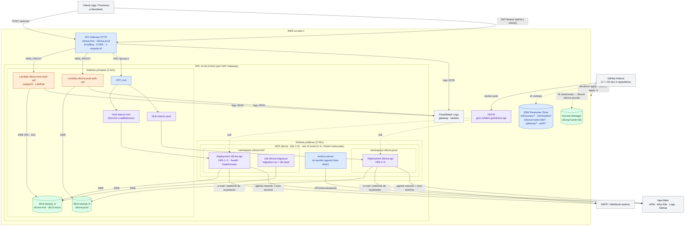

# Diagrama de componentes — visão de nuvem (Fase 3)

Como os quatro repositórios se materializam na AWS (conta Academy Learner Lab, `us-east-1`),
quem fala com quem e por onde passa a observabilidade. Cores: azul = `oficina-infra-k8s`,
verde = `oficina-infra-db`, laranja = `oficina-auth-lambda`, roxo = `oficina-api`.

## Componentes por repositório

| Repositório | Componentes na figura | Contrato publicado |
| --- | --- | --- |
| [`oficina-infra-k8s`](https://github.com/Fabio-GST/oficina-infra-k8s) | VPC, subnets, EKS, node group, metrics-server, Cluster Autoscaler, namespaces, API Gateway + VPC Link, agente New Relic do cluster | SSM `/oficina/vpc/*`, `/oficina/eks/*`, `/oficina/<amb>/namespace`, `/oficina/<amb>/gateway/*` |
| [`oficina-infra-db`](https://github.com/Fabio-GST/oficina-infra-db) | RDS por ambiente, security groups, parameter group, Secrets Manager | SSM `/oficina/<amb>/db/*`; segredo `oficina/<amb>/db` |
| [`oficina-auth-lambda`](https://github.com/Fabio-GST/oficina-auth-lambda) | Lambda por ambiente, SG, regra 3306 no SG do banco, rota `POST /auth/cpf`, Function URL | SSM `/oficina/<amb>/auth/*` |
| **`oficina-api`** (este) | Deployment + HPA + Service (NLB) + ConfigMap + Secret + Job de migração via Kustomize; imagem no GHCR | NLB descoberto por tag `kubernetes.io/service-name` |

## Fluxos principais

1. **Autenticação por CPF**: cliente → gateway → Lambda → RDS (`clientes.documento`, `ativo`) →
   JWT HS256 (`papel: cliente`). Detalhe em [diagrama de sequência](./diagrama-de-sequencia.md).
2. **Chamada autenticada**: cliente/atendente → gateway (`x-request-id`) → VPC Link → NLB →
   pod da API → `AutenticacaoMiddleware` + `PapelMiddleware` → caso de uso → RDS → eventos de
   domínio → Políticas (e-mail, estoque, pagamento) → New Relic.
3. **Deploy**: push em `homolog`/`main` → CI → CD: imagem no GHCR, kubeconfig via SSM, Secret a
   partir do Secrets Manager, `kubectl apply -k overlays/<amb>`, Job de migração, `rollout`,
   smoke test pela URL do gateway.
4. **Observabilidade**: APM e logs com `trace.id` da API, métricas de pods/nós do cluster,
   logs do gateway e da Lambda no CloudWatch; dashboards e alertas na RFC 0004.

## Decisões relacionadas

RFC 0001 (nuvem), RFC 0002 (banco), RFC 0003 (autenticação), RFC 0004 (observabilidade);
ADR 0002 (quatro repositórios), ADR 0003 (gateway), ADR 0004 (HPA), ADR 0005 (comunicação),
ADR 0006 (migrações).
