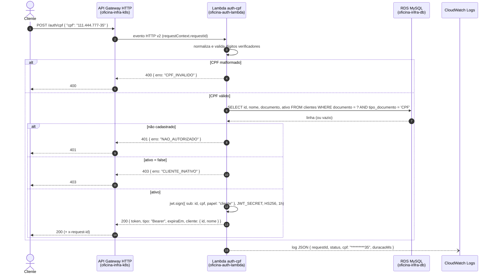
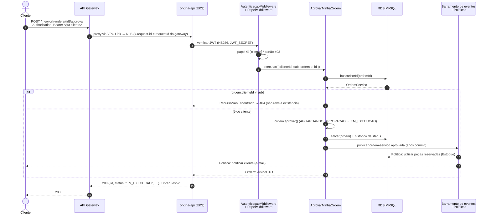
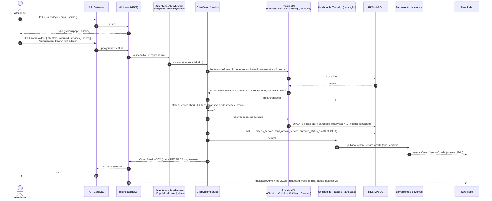

# Diagramas de sequência — autenticação por CPF e abertura de Ordem de Serviço

## 1. Autenticação do cliente por CPF

Pontos de atenção: o CPF nunca aparece completo nos logs; o segredo `JWT_SECRET` é o mesmo da
API (contrato testado nos dois repositórios); a validade do token é de 1 hora.

## 2. Uso do token no portal do cliente: consultar e aprovar a própria OS

## 3. Abertura de Ordem de Serviço pelo atendente

Em caso de falha na reserva de estoque (saldo insuficiente), o `rollback` da Unidade de Trabalho
desfaz a OS e os itens: estoque e OS nunca ficam inconsistentes (RFC 0002).

## Relacionados

- [Diagrama de componentes](./diagrama-de-componentes.md)
- [RFC 0003 — Estratégia de autenticação](../rfc/0003-estrategia-de-autenticacao.md)
- [ADR 0001 — Arquitetura orientada a eventos](../adr/0001-arquitetura-orientada-a-eventos.md)
- [Mapa de contexto](../diagrama-de-contexto.md)
